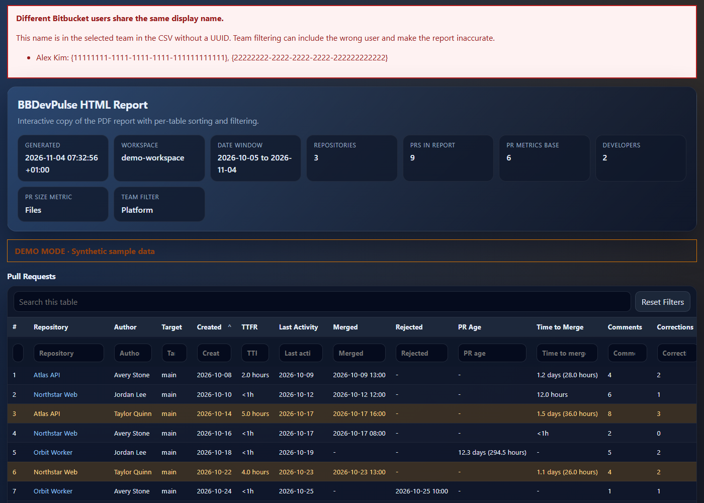
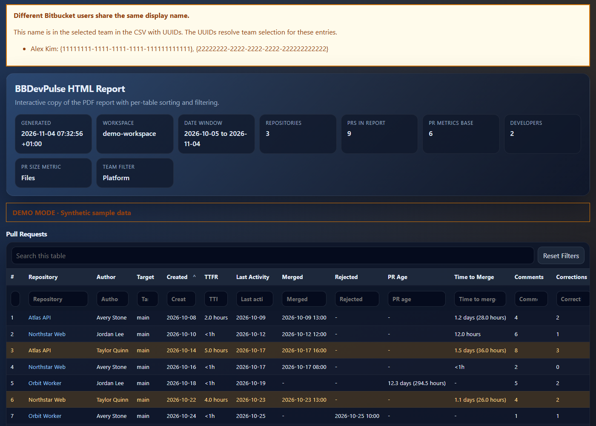

# BBDevPulse


BBDevPulse is a .NET 10 console application that analyzes Bitbucket Cloud pull requests, review activity, and developer contributions. It displays a console report and can save HTML and PDF reports. A built-in demo mode produces the same report from synthetic data without contacting Bitbucket.

## Contents

- [Quick start: synthetic demo](#quick-start-synthetic-demo)
- [Live Bitbucket run](#live-bitbucket-run)
- [Configuration reference](#configuration-reference)
- [Scope and team filtering](#scope-and-team-filtering)
- [Reports and metrics](#reports-and-metrics)
- [Build and test](#build-and-test)

## Quick start: synthetic demo

The committed sample `BBDevPulse/appsettings.json` has `Bitbucket:DemoMode` set to `true`. With the .NET 10 SDK installed, run from the repository root:

```powershell
dotnet run --project BBDevPulse/BBDevPulse.csproj
```

Choose **Do not apply team filter** or one of the synthetic teams. The menu shows a count for each team; selecting one previews its people and grades before the report settings and confirmation prompt. Confirm to render the report. Demo mode reads an [embedded synthetic people CSV](BBDevPulse/Demo/people.csv), uses synthetic repositories, PRs, and activity, and does not access Bitbucket or the configured `PeopleCsvPath`. Credentials and other live Bitbucket settings are not needed for this mode.

Demo mode always writes dated `bbdevpulse-demo-report_*.html` and `bbdevpulse-demo-report_*.pdf` files to the current working directory. Selecting a team adds its normalized name to the beginning of each filename. The configured HTML/PDF paths and `Html.OpenInBrowser` are ignored in demo mode.

### Demo screenshots

Team selection, with the **Platform** option highlighted:


Startup logo, tool description, and settings shown after selecting Platform, before confirming the run:


The generated HTML report shows the selected team and highlights PRs authored outside it:


### Generated sample reports

These files were generated by running the current demo mode with the unfiltered and **Platform** selections. The names, repositories, activity, and metrics are synthetic. Download the HTML files and open them locally to use their sorting and filtering controls.

| Selection | HTML | PDF |
| --- | --- | --- |
| No team filter | [Interactive HTML](examples/demo-all.html) | [PDF](examples/demo-all.pdf) |
| Platform team | [Interactive HTML](examples/demo-platform.html) | [PDF](examples/demo-platform.pdf) |

## Live Bitbucket run

Set `Bitbucket:DemoMode` to `false` in `BBDevPulse/appsettings.json`, then configure the workspace, `Username`, `AppPassword`, repository and branch selection, and a date window. Keep real credentials and local paths out of commits. See the [configuration reference](#configuration-reference) for each setting, then run the same `dotnet run` command shown above.

Before any Bitbucket request, the application:

1. Reads `PeopleCsvPath` if configured and accessible. When it finds departments, it offers a team picker. Choosing a team shows its people and grades in pages of 12.
2. Shows the effective UTC date window, dates excluded from duration calculations, workspace and Bitbucket user, repository selection rules, merge target branches, PR time and size modes, developer output options, and planned output filenames.
3. Waits for confirmation before authenticating and loading repositories.

The startup warning highlights that `ShowAllDetailsForDevelopers = true` can substantially increase report generation time. If the people CSV is missing or inaccessible, the run continues without a team picker or team filter.

## Configuration reference

All settings are inside the `Bitbucket` object in `BBDevPulse/appsettings.json`. The committed file is a safe demo example; live settings are local to your installation.

| Setting | Effect |
| --- | --- |
| `DemoMode` | `true` uses the built-in synthetic data and fixed demo outputs. |
| `Days` | Positive rolling lookback from the current UTC time. Used when `FromDate` and `ToDate` are empty. |
| `FromDate`, `ToDate` | Inclusive UTC calendar-day range; both must be set together. Accept `dd.MM.yyyy` or `yyyy-MM-dd`. |
| `Workspace` | Bitbucket workspace to search in live mode. |
| `Username`, `AppPassword` | Bitbucket Cloud Basic authentication credentials for live mode. |
| `PageLength` | Page size for Bitbucket API requests. |
| `RepositoryConcurrency`, `PullRequestConcurrency` | Maximum parallel repository and per-repository PR analysis. |
| `MaxRetries`, `RetryDelayStepSeconds`, `MaxRetryDelaySeconds` | Retry limit and backoff for retryable API requests. |
| `RepoSearchMode`, `RepoNameFilter`, `RepoNameList` | Choose `SearchByFilter` with `RepoNameFilter`, or `FilterFromTheList` with `RepoNameList`; see [repository selection](#repository-and-branch-selection). |
| `BranchNameList` | Destination branches included in PR analysis. |
| `PrTimeFilterMode` | `LastKnownUpdateAndCreated` or `CreatedOnOnly`; controls selection by date. See [PR date and activity selection](#pr-date-and-activity-selection). |
| `PullRequestSizeMode` | `Lines` (default) or `Files`; controls size tiers and aggregates. |
| `ExcludeWeekend`, `ExcludedDays` | Exclude Saturdays/Sundays and specified dates from duration calculations. Dates accept the same formats as `FromDate`. |
| `ForcedIncludeDates` | Optional dates counted as working days even if they are weekends or appear in `ExcludedDays`. For example, add `"2026-11-07"` to count that Saturday while other weekends remain excluded. Dates accept `dd.MM.yyyy` or `yyyy-MM-dd`; leave `[]` if unused. Affects duration metrics only. |
| `PeopleCsvPath` | Optional file for live developer metadata and team choices; see [People CSV](#people-csv). |
| `ShowDeveloperUuidInStats` | Show Bitbucket UUIDs beside developers in statistics; default `false`. |
| `ShowAllDetailsForDevelopers` | Include per-developer PR, comment, approval, and commit details; default `false`. May substantially increase generation time. |
| `Telemetry.Enabled` | Show live API request and cache telemetry in the console; default `true`. |
| `Html.Enabled`, `Html.OutputPath`, `Html.OpenInBrowser` | Generate HTML at the specified path and optionally open it. |
| `Pdf.Enabled`, `Pdf.OutputPath` | Generate PDF at the specified path. |

Live output paths receive a local-date suffix (`dd_MM_yyyy`) before the extension. A selected team adds a normalized team-name prefix. Relative paths resolve from the process's working directory. Disabled formats show as disabled in the startup summary.

### People CSV

The optional people CSV has this format:

```text
Name;Grade;Department
Alice Doe;Senior;Core
Bob Smith;Middle;Import
```

An optional fourth `UUID` column distinguishes people with the same display name:

```text
Name;Grade;Department;UUID
Alex Kim;Senior;Platform;{11111111-1111-1111-1111-111111111111}
Alex Kim;Middle;Core;{22222222-2222-2222-2222-222222222222}
Alice Doe;Senior;Core;
```

The original three-column format remains supported. If the same name occurs more than once in one department, every such row must have a UUID. A UUID must be unique across the whole CSV, including across departments; comparison ignores case and accepts values with or without braces. Validation compares names and departments without regard to case. Invalid CSV stops the run before Bitbucket requests and prints an error with the affected lines.

**Planned breaking change:** A future version will likely require both the name and UUID for every CSV entry, allowing the application to check both fields and reduce matching errors.

To find the UUIDs for the CSV, set `ShowDeveloperUuidInStats` to `true` and run a report without a team filter. If the CSV is not yet valid, temporarily clear `PeopleCsvPath` so the report can start without reading it. Copy the UUIDs shown in the developer statistics into the corresponding CSV rows, restore `PeopleCsvPath` if needed, then run the report again and select the desired team. The report shows developers observed in the selected repositories and date range, so adjust that scope if a person is missing.

Names must match Bitbucket display names exactly. When a UUID is present, both the name and UUID must match. For a name with both UUID-specific and blank-UUID rows, an exact UUID match takes precedence and the blank-UUID row is the fallback. A UUID-specific row is not assigned to a different UUID. Names without UUIDs may occur in different departments: each department remains selectable, but the application cannot determine which person belongs to which department from the name alone. If more than one blank-UUID row matches a name, ambiguous grade and department enrichment is omitted. Departments form the team choices, with duplicate department names grouped without regard to case. A developer without a CSV match retains `N/A` metadata. Without departments, there is no team picker.

### Analysis cache and telemetry

In live mode, BBDevPulse caches PR activity, correction commits, and diffstat snapshots in `AppContext.BaseDirectory/cache/pull-request-analysis`. An unchanged PR can reuse its snapshot on a later run. The cache has no automatic eviction. When telemetry is enabled, the console shows actual HTTP requests, cache hits/misses/stores, estimated avoided requests, and a request breakdown by API endpoint.

Cached supplemental data distinguishes a successful empty or zero measurement from a failed request and from data not requested. Older version 2 entries without explicit availability are still readable; when a field was not available, its original reason remains unknown and the application may retry the request. Contradictory or malformed cache entries are treated as misses. Cache validity does not establish that the Bitbucket activity response is historically complete.

Bitbucket pull requests must have a positive ID and a creation timestamp; a response missing either cannot be analyzed. Unknown PR states are retained as `Unknown`, and optional timestamps and destination fields may be absent. A missing user UUID follows the warning and exclusion policy described below. A missing display name falls back to the UUID when possible. These rules describe the application boundary; they do not imply that Bitbucket guarantees every optional field.

## Scope and team filtering

### Repository and branch selection

- `SearchByFilter` selects repositories whose name or slug contains `RepoNameFilter`; `FilterFromTheList` matches names or slugs exactly against `RepoNameList`. Both comparisons ignore case. An empty filter or list includes all repositories.
- `BranchNameList` limits PRs by destination branch, ignoring case. An empty list accepts every target branch.

### PR date and activity selection

- `LastKnownUpdateAndCreated` uses the PR's Bitbucket `updated_on` field as **LastKnownUpdate**. It selects PRs created or last updated on or after the start of the period. If neither date falls on or after the start, the PR is excluded. Bitbucket does not document exactly which actions update this field, so minor activity such as comments may not be reflected. With an end date, PRs created after it are excluded, but `updated_on` can be later. Repository and destination-branch filters also apply. See [Bitbucket's pull request properties](https://support.atlassian.com/bitbucket-cloud/docs/event-payloads/).
- After this initial selection, a PR created before the period is included only if its activity contains an event with a recognized date inside the period. The event can be a comment, approval, PR update, or another activity whose date the application recognizes; it does not have to be a code change. Commits are loaded only after this check and do not independently qualify a PR. `CreatedOnOnly` instead limits the initial selection to PRs created on or after the start date.
- Comment and approval statistics include only events within the report period on PRs that pass these selection rules and, when applicable, the team filter. Comments on other PRs are not counted, even if a team member wrote them during the period. The activity reader currently stops at the first event dated before the period; if Bitbucket returns later in-period events after it, those events can also be missed, and an older PR may be excluded altogether. Existing cached activity can preserve an incomplete result.

### Team filtering

With a team chosen from the [people CSV](#people-csv), the PR table includes PRs authored by team members and external-author PRs on which team members were active. External-author rows are marked in orange in the console and PDF. Only team-authored PRs contribute to PR metrics; review activity on external PRs still contributes to the selected developers' statistics.

## Reports and metrics

The console, HTML, and PDF show PR and developer tables, PR throughput, merge time, time to first reaction (TTFR), comments, peer comments, corrections, PR size, and worst PRs by metric. When enabled, developer detail sections include authored PRs, comments, approvals, and follow-up commits. HTML detailed tables support sorting and filtering; summary statistic tables are static.

Historical reports are not snapshots of Bitbucket at the end of the selected period. Some fields use the data available when the report is generated and may differ from their historical values:

- **PR state:** a PR that was open at the end of the period may now be shown as merged or declined. Rejection dates and counts also depend on the current state and available timestamps.
- **PR size:** the diff and size tier use the available source and destination revisions, which may have changed after the period. Size statistics and biggest-PR rankings can therefore differ from their historical values.
- **Corrections:** the count uses the currently available PR commit list, filtered by commit date. Rewritten history can change the result for a past period.
- **Author, target branch and repository name:** these use the values available when generating the report and may have changed since the selected period. Current target-branch and team filters can consequently change which PRs are included.

`Comments` on a PR counts its recognized comments within the report period, subject to the [selection and activity-reading limits](#pr-date-and-activity-selection). `Peer Comments` counts a developer's comments on other people's selected PRs; self-comments and comments on PRs with an unknown author do not count as peer comments. Duration metrics exclude weekends and explicit `ExcludedDays` only when configured. `ForcedIncludeDates` overrides both rules for working weekends or rescheduled holidays. PRs and activity on excluded dates remain eligible for the report.

`PRs per Developer` includes zero opened PRs for developers present in the report's developer statistics, including reviewers who opened no PRs during the period. People who do not appear in the analyzed activity are not automatically included from the people CSV, so this distribution is not necessarily for the whole team.

PR size comes from Bitbucket diffstat. `PullRequestSizeMode = Lines` uses added plus removed lines; `Files` uses the count of changed files. The selected measure drives the PR `Size` tier, size statistics, and the biggest-PR selection:

| Tier | Lines changed | Files changed |
| --- | ---: | ---: |
| XS | 0–100 | 0–2 |
| S | 101–300 | 3–5 |
| M | 301–700 | 6–10 |
| L | 701–1200 | 11–20 |
| XL | Over 1200 | Over 20 |

If diffstat is unavailable, that PR has no size value and is omitted from size aggregates. Reports distinguish unavailable correction data from a measured zero.

### Duplicate display names

Developer statistics and identity comparisons use Bitbucket UUIDs, ignoring case. Different UUIDs remain separate even when their display names match. If Bitbucket does not provide a UUID for a user, console, HTML, and PDF reports show a warning: that user's activity is excluded, and a PR whose author has no UUID is excluded entirely. Missing authors are treated the same way. The warning covers users encountered in the data fetched for the run.

When different Bitbucket UUIDs share a name, a warning lists the name and UUIDs. With a team filter selected, the warning is yellow if the name is outside that team, red if a matching team entry has no UUID, and yellow if the selected team's matching entries have UUIDs. In the red case, both users may pass the filter, even if only one belongs to the team. With no team filter, the warning is yellow and notes that CSV enrichment may still be ambiguous. CSV name matching is case-sensitive; collision detection is case-insensitive and covers only identities observed during the run. UUID matching relies on the CSV being accurate and does not verify team membership. The screenshots below show a synthetic collision added to a demo report with the Platform filter selected.

<details>
<summary>Show example warning screenshots</summary>

Name outside the selected team (yellow):


Name in the selected team without a UUID (red):



Name in the selected team with a UUID (yellow):



</details>

## Build and test

```powershell
dotnet build BBDevPulse.slnx
dotnet test BBDevPulse.slnx
```
