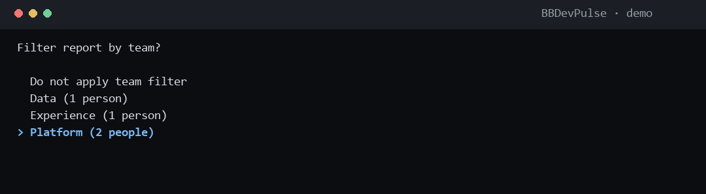
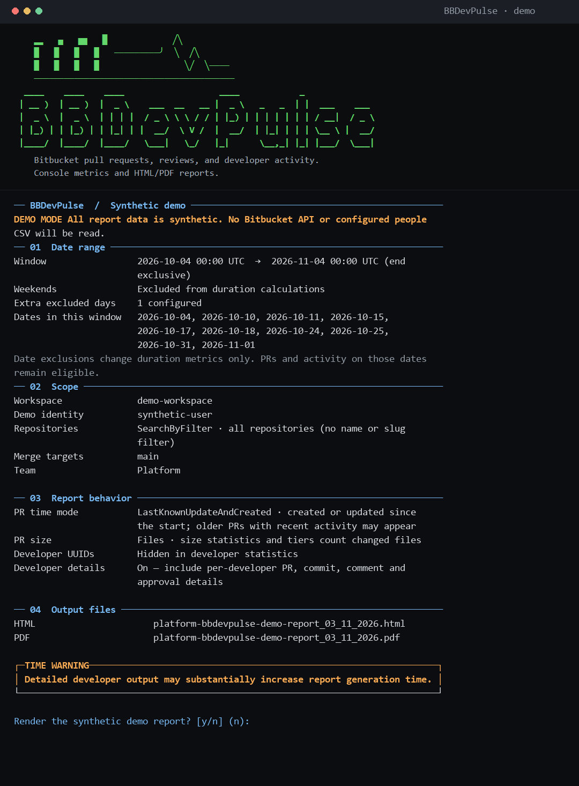
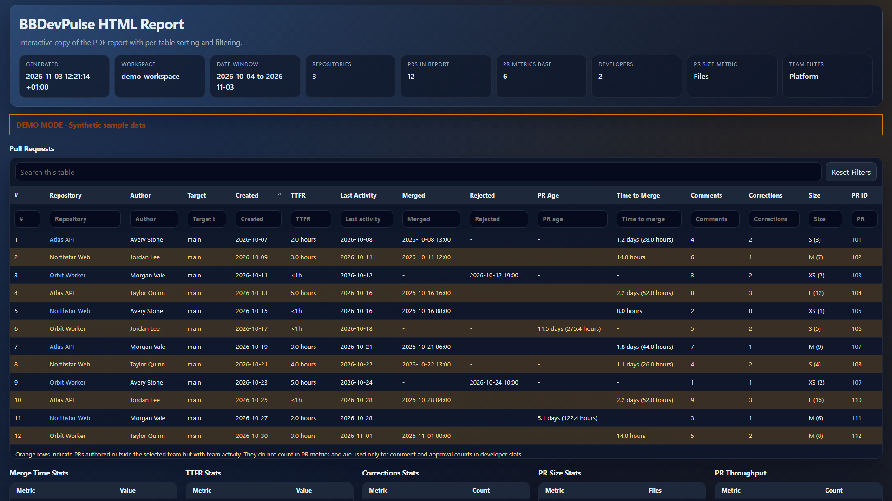
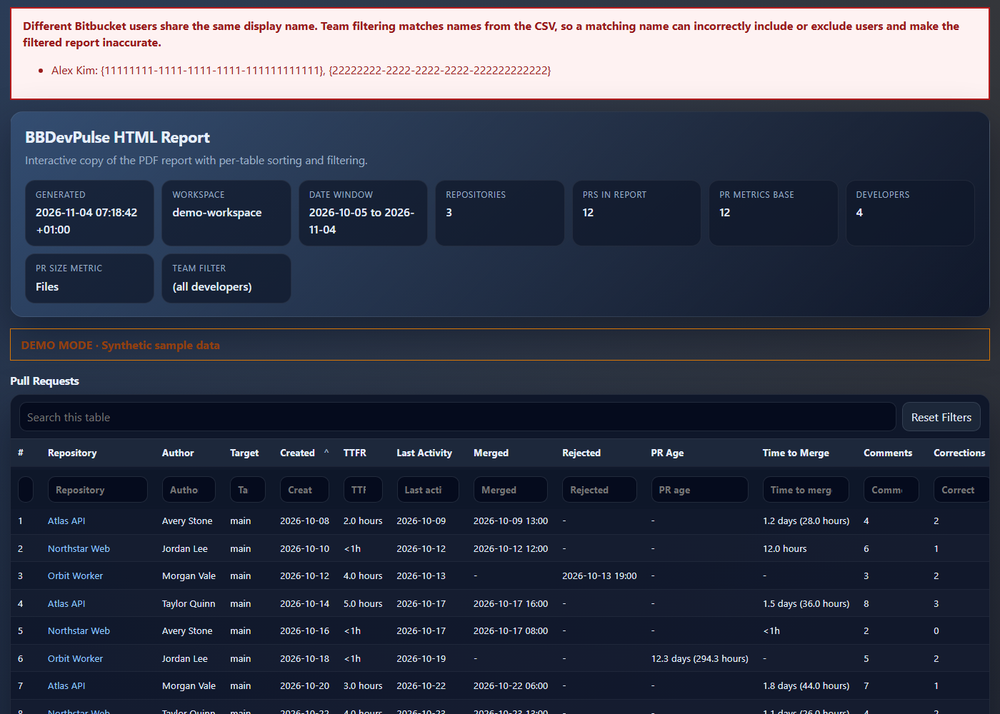
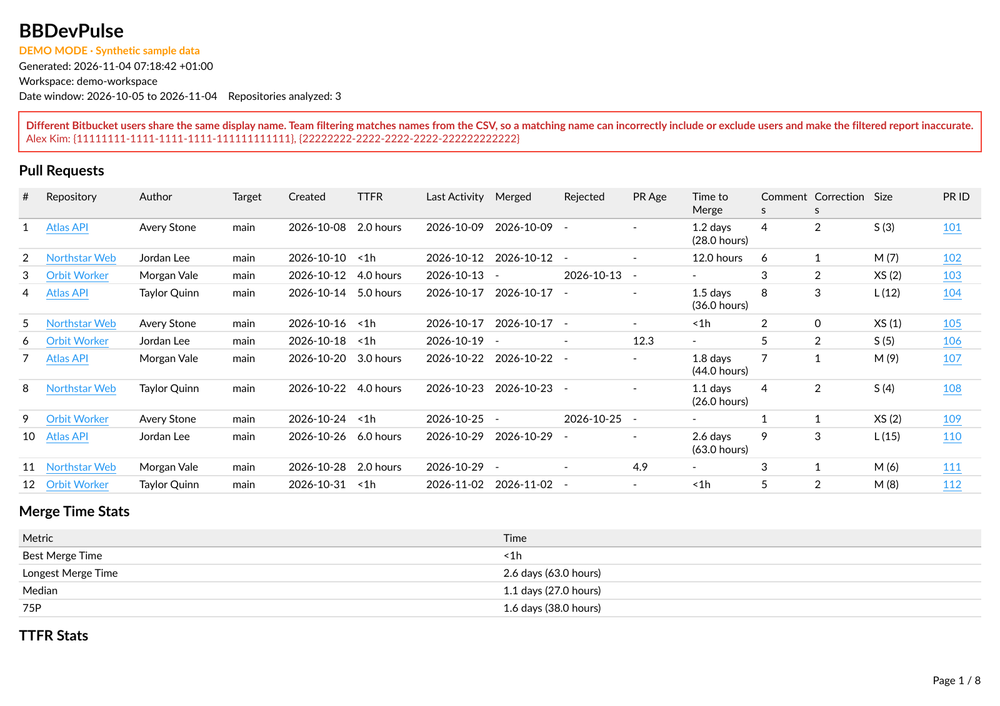

# BBDevPulse


BBDevPulse is a .NET 10 console application that analyzes Bitbucket Cloud pull requests, review activity, and developer contributions. It displays a console report and can save HTML and PDF reports. A built-in demo mode produces the same report from synthetic data without contacting Bitbucket.

## Quick start: synthetic demo

The committed sample `BBDevPulse/appsettings.json` has `Bitbucket:DemoMode` set to `true`. With the .NET 10 SDK installed, run from the repository root:

```powershell
dotnet run --project BBDevPulse/BBDevPulse.csproj
```

Choose **Do not apply team filter** or one of the synthetic teams. The menu shows a count for each team; selecting one previews its people and grades before the report settings and confirmation prompt. Confirm to render the report. Demo mode reads an [embedded synthetic people CSV](BBDevPulse/Demo/people.csv), uses synthetic repositories, PRs, and activity, and does not access Bitbucket or the configured `PeopleCsvPath`. Credentials and other live Bitbucket settings are not needed for this mode.

Demo mode always writes dated `bbdevpulse-demo-report_*.html` and `bbdevpulse-demo-report_*.pdf` files to the current working directory. Selecting a team adds its normalized name to the beginning of each filename. The configured HTML/PDF paths and `Html.OpenInBrowser` are ignored in demo mode.

### Demo screenshots

Team selection, with the **Platform** option highlighted:



Startup logo, tool description, and settings shown after selecting Platform, before confirming the run:



The generated HTML report shows the selected team and highlights PRs authored outside it:



### Generated sample reports

These files were generated by running the current demo mode with the unfiltered and **Platform** selections. The names, repositories, activity, and metrics are synthetic. Download the HTML files and open them locally to use their sorting and filtering controls.

| Selection | HTML | PDF |
| --- | --- | --- |
| No team filter | [Interactive HTML](examples/demo-all.html) | [PDF](examples/demo-all.pdf) |
| Platform team | [Interactive HTML](examples/demo-platform.html) | [PDF](examples/demo-platform.pdf) |

## Live Bitbucket run

Set `Bitbucket:DemoMode` to `false` in `BBDevPulse/appsettings.json`, then configure the workspace, `Username`, `AppPassword`, repository and branch selection, and a date window. Keep real credentials and local paths out of commits. Run the same `dotnet run` command shown above.

Before any Bitbucket request, the application:

1. Reads `PeopleCsvPath` if configured and accessible. When it finds departments, it offers a team picker. Choosing a team shows its people and grades in pages of 12.
2. Shows the effective UTC date window, dates excluded from duration calculations, workspace and Bitbucket user, repository selection rules, merge target branches, PR time and size modes, developer output options, and planned output filenames.
3. Waits for confirmation before authenticating and loading repositories.

The startup warning highlights that `ShowAllDetailsForDevelopers = true` can substantially increase report generation time. If the people CSV is missing or inaccessible, the run continues without a team picker or team filter.

### Scope and team filtering

- `SearchByFilter` selects repositories whose name or slug contains `RepoNameFilter`; `FilterFromTheList` matches names or slugs exactly against `RepoNameList`. Both comparisons ignore case. An empty filter or list includes all repositories.
- `BranchNameList` limits PRs by destination branch, ignoring case. An empty list accepts every target branch.
- `LastKnownUpdateAndCreated` includes older PRs that have recent updates; `CreatedOnOnly` stops at PRs created before the start date. These modes control how PR pages are read.
- With a selected team, the PR table includes PRs authored by team members and external-author PRs on which team members were active. External-author rows are marked in orange in the console and PDF. Only team-authored PRs contribute to PR metrics; review activity on external PRs still contributes to the selected developers' statistics.

The optional people CSV has this format:

```text
Name;Grade;Department
Alice Doe;Senior;Core
Bob Smith;Middle;Import
```

Names must match Bitbucket display names exactly to enrich developer statistics. Departments form the team choices, with duplicate department names grouped without regard to case. A developer without a CSV match retains `N/A` metadata. Without departments, there is no team picker.

### Duplicate display names

If the Bitbucket data read during a run contains the same display name for different UUIDs, a red warning at the beginning of the console, HTML, and PDF reports lists the name and UUIDs. Check the report manually: developer statistics may be combined and cannot be considered fully accurate. Names and UUIDs are compared without regard to case; users without a UUID cannot establish a collision. Detection covers identities observed in the PRs and activities fetched for the run, not every user in the workspace.

This is expected to be unlikely in small organizations. The warning does not resolve collisions; a fix for separating identities will be prepared if an actual collision is encountered. The screenshots below use synthetic identities added specifically for this example.

HTML report:



PDF report:



## Reports and metrics

The console, HTML, and PDF show PR and developer tables, PR throughput, merge time, time to first reaction (TTFR), comments, peer comments, corrections, PR size, and worst PRs by metric. When enabled, developer detail sections include authored PRs, comments, approvals, and follow-up commits. HTML detailed tables support sorting and filtering; summary statistic tables are static.

`Comments` on a PR is its total comment count. `Peer Comments` counts a developer's comments on other people's PRs; self-comments and comments on PRs with an unknown author do not count as peer comments. Duration metrics exclude weekends and explicit `ExcludedDays` only when configured. `ForcedIncludeDates` overrides both rules for working weekends or rescheduled holidays. PRs and activity on excluded dates remain eligible for the report.

PR size comes from Bitbucket diffstat. `PullRequestSizeMode = Lines` uses added plus removed lines; `Files` uses the count of changed files. The selected measure drives the PR `Size` tier, size statistics, and the biggest-PR selection:

| Tier | Lines changed | Files changed |
| --- | ---: | ---: |
| XS | 0–100 | 0–2 |
| S | 101–300 | 3–5 |
| M | 301–700 | 6–10 |
| L | 701–1200 | 11–20 |
| XL | Over 1200 | Over 20 |

If diffstat is unavailable, that PR has no size value and is omitted from size aggregates. Reports distinguish unavailable correction data from a measured zero.

## Configuration reference

All settings are inside the `Bitbucket` object in `BBDevPulse/appsettings.json`. The committed file is a safe demo example; live settings are local to your installation.

| Setting | Effect |
| --- | --- |
| `DemoMode` | `true` uses the built-in synthetic data and fixed demo outputs. |
| `Days` | Positive rolling lookback from the current UTC time. Used when `FromDate` and `ToDate` are empty. |
| `FromDate`, `ToDate` | Inclusive UTC calendar-day range; both must be set together. Accept `dd.MM.yyyy` or `yyyy-MM-dd`. |
| `Workspace` | Bitbucket workspace to search in live mode. |
| `Username`, `AppPassword` | Bitbucket Cloud Basic authentication credentials for live mode. |
| `PageLength` | Page size for Bitbucket API requests. |
| `RepositoryConcurrency`, `PullRequestConcurrency` | Maximum parallel repository and per-repository PR analysis. |
| `MaxRetries`, `RetryDelayStepSeconds`, `MaxRetryDelaySeconds` | Retry limit and backoff for retryable API requests. |
| `RepoSearchMode`, `RepoNameFilter`, `RepoNameList` | Repository selection as described above. Modes: `SearchByFilter`, `FilterFromTheList`. |
| `BranchNameList` | Destination branches included in PR analysis. |
| `PrTimeFilterMode` | `LastKnownUpdateAndCreated` or `CreatedOnOnly`; controls the PR paging cutoff. |
| `PullRequestSizeMode` | `Lines` (default) or `Files`; controls size tiers and aggregates. |
| `ExcludeWeekend`, `ExcludedDays` | Exclude Saturdays/Sundays and specified dates from duration calculations. Dates accept the same formats as `FromDate`. |
| `ForcedIncludeDates` | Optional dates counted as working days even if they are weekends or appear in `ExcludedDays`. For example, add `"2026-11-07"` to count that Saturday while other weekends remain excluded. Dates accept `dd.MM.yyyy` or `yyyy-MM-dd`; leave `[]` if unused. Affects duration metrics only. |
| `PeopleCsvPath` | Optional `Name;Grade;Department` file for live developer metadata and team choices. |
| `ShowDeveloperUuidInStats` | Show Bitbucket UUIDs beside developers in statistics; default `false`. |
| `ShowAllDetailsForDevelopers` | Include per-developer PR, comment, approval, and commit details; default `false`. May substantially increase generation time. |
| `Telemetry.Enabled` | Show live API request and cache telemetry in the console; default `true`. |
| `Html.Enabled`, `Html.OutputPath`, `Html.OpenInBrowser` | Generate HTML at the specified path and optionally open it. |
| `Pdf.Enabled`, `Pdf.OutputPath` | Generate PDF at the specified path. |

Live output paths receive a local-date suffix (`dd_MM_yyyy`) before the extension. A selected team adds a normalized team-name prefix. Relative paths resolve from the process's working directory. Disabled formats show as disabled in the startup summary.

### Analysis cache and telemetry

In live mode, BBDevPulse caches PR activity, correction commits, and diffstat snapshots in `AppContext.BaseDirectory/cache/pull-request-analysis`. An unchanged PR can reuse its snapshot on a later run. The cache has no automatic eviction. When telemetry is enabled, the console shows actual HTTP requests, cache hits/misses/stores, estimated avoided requests, and a request breakdown by API endpoint.

## Build and test

```powershell
dotnet build BBDevPulse.slnx
dotnet test BBDevPulse.slnx
```
